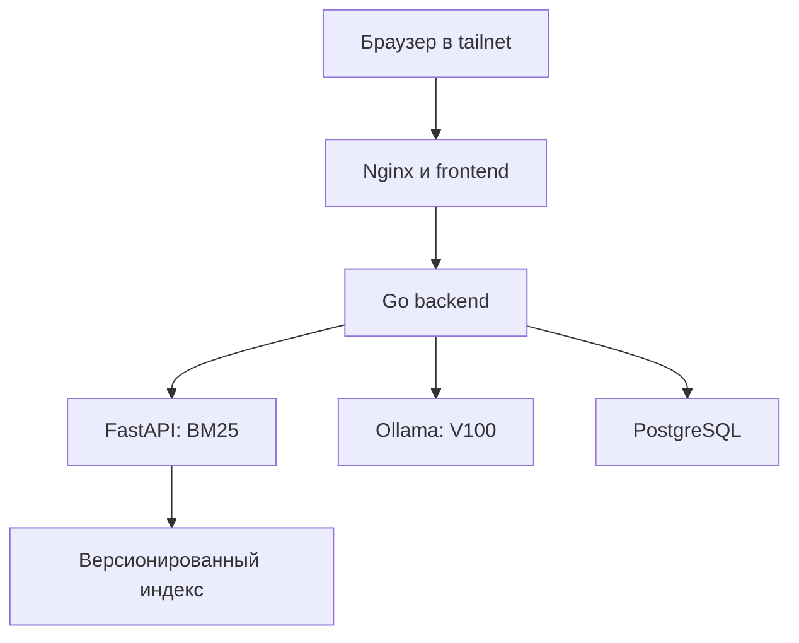

# Архитектура

## Статус и решения

Это целевая архитектура, принятая для реализации. На точке 1 комплект содержит документацию и автономный прототип; контейнеры, серверная установка и API пока не представлены как выполненные работы.

## Физическое размещение

| Узел | Роль |
| --- | --- |
| GitHub | Репозиторий, Issues, PR, Actions; GHCR для будущих образов |
| Кафедральный сервер команды | Debian 13, CPU 12600K, RAM 96 ГБ, V100 16 ГБ; все пять сервисов и будущий deployment runner |
| Компьютеры команды | Разработка, браузер, Tailscale; административный доступ по роли |

Сервер за NAT соединяется с Tailscale исходящими соединениями. Собственный центральный VPN-сервер и домашний роутер не нужны. Tailscale использует внешнюю координацию и при необходимости relay; нельзя гарантировать direct-соединение в любой сети. HTTPS интерфейса — через Tailscale Serve к loopback Nginx.

## Логические связи

## Контейнеры и сеть

| Сервис | Внутренний адрес | Данные |
| --- | --- | --- |
| frontend | `frontend:80` | Собранные статические assets |
| backend | `backend:8080` | Конфигурация; БД отдельно |
| search | `search:8000` | Read-only prepared index и corpus metadata |
| llm | `llm:11434` | Постоянный том моделей |
| postgres | `postgres:5432` | Постоянный том БД |

На хосте публикуется только `127.0.0.1:8080` → frontend:80; Serve предоставляет его в tailnet. Backend/search/LLM/БД наружу не публикуются. В dev Vite :5173 проксирует Go :8081; search :8000 и тестовая БД доступны только локально.

## Запрос

1. Backend определяет cookie-сессию, проверяет chat ownership, текст и очередь.
2. Из чата берёт distribution/release; из ограниченной истории — контекст уточнения.
3. Вызывает search с query/target/top_k. Search возвращает совместимые chunks.
4. Если контекст отсутствует, возвращает честное no_context. Если зависимость сломана, возвращает ошибку.
5. Нумерует источники и формирует prompt с target, chunks и ограниченной историей.
6. Вызывает Ollama через `/v1/chat/completions`; передаёт JSON либо собственные SSE-события.
7. Сохраняет ответ и полные snapshots источников. Отмена сохраняет partial content и освобождает ресурсы.

## Начальные ограничения

Одна генерация GPU, очередь из трёх ожидающих, одна генерация на чат; вопрос 1–4000 Unicode-символов; top_k 5 (API search допускает 1–10); deadline 180 с; context 8192 токена, output 1024. Это параметры первой проверки, не обещание скорости. Веса модели и KV-cache должны помещаться в 16 ГБ VRAM. RAM хоста не увеличивает VRAM.

## Надёжность

Health означает живой процесс; ready — доступность нужных зависимостей и подготовленных данных. Наличие модельного файла проверяется без полной генерации на каждом healthcheck. Модель прогревается отдельно перед измерением warm latency.

Обычный deploy не удаляет тома и не скачивает модель повторно. Старые images/index сохраняются для rollback; миграции БД учитываются отдельно. Snapshot источника делает прежний ответ воспроизводимым относительно использованного текста. Backup базы и corpus проверяется восстановлением в отдельной среде.

При выключении кафедрального сервера приложение недоступно: это принятая для учебной команды единая точка отказа. Производительность и фактическое использование GPU подтверждаются измерениями на следующей контрольной точке.
